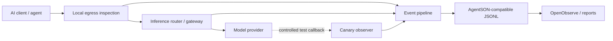

# AI Trust Observatory

**An independent, open-source AI inference supply-chain assurance and observability research framework.**

AI Trust Observatory investigates how organisations can observe AI inference routes, test data-handling behaviour with synthetic canaries, and produce reproducible evidence about what happens to prompts as they move through provider and reseller chains.

> **Status: early-stage research scaffold.** This project is not a commercial AI firewall, provider certification, or proof of Zero Data Retention.

## Research objectives

- Inventory providers, models, endpoints, routers and declared subprocessors.
- Inspect outbound prompts locally for synthetic credentials and configured sensitive-data patterns.
- Generate unique, non-production canary identifiers for controlled experiments.
- Correlate canary callbacks with test runs and request metadata.
- Record structured evidence in portable JSONL.
- Produce timelines and reports that distinguish observation from inference.

## Reference architecture

## Research principles

1. **Synthetic data only.** Never plant production credentials, customer secrets or real personal data.
2. **Authorised testing.** Test only endpoints where the activity is permitted.
3. **Least privilege.** Use isolated sandbox accounts and inert credential-shaped strings.
4. **Evidence before claims.** Preserve timestamps, correlation IDs, test configuration and uncertainty.
5. **No overclaiming.** A callback indicates a canary was accessed; it does not alone prove credential theft, malicious intent or successful exfiltration.
6. **Retention claims are bounded.** External observations cannot conclusively prove that no copy was retained anywhere.
7. **Privacy by design.** Minimise prompt capture; default to metadata and redacted evidence.

## Repository layout

- `docs/` — methodology and architecture
- `schemas/` — event JSON Schema
- `examples/` — synthetic event examples
- `site/` — static landing page
- `.github/workflows/` — CI validation

## Planned integrations

AgentSON event envelopes, OpenObserve, Wazuh, Ollama, OpenRouter and isolated AWS test accounts are candidate integrations, not completed integrations.

## Roadmap

- [x] Define research scope and safety boundaries
- [x] Draft event vocabulary and JSON Schema
- [ ] Implement synthetic canary generator
- [ ] Implement local prompt egress inspection prototype
- [ ] Implement controlled callback observer
- [ ] Add provider and route inventory
- [ ] Add event correlation and evidence report generator
- [ ] Add reproducible test harness and documented limitations

## Getting started

This initial repository contains research documentation, a draft event schema, synthetic examples and a static landing page. Runtime collectors and provider adapters are planned work. Open `site/index.html` locally to preview the landing page.

## Contributing

See [CONTRIBUTING.md](CONTRIBUTING.md) and [SECURITY.md](SECURITY.md). Use synthetic data and authorised infrastructure only.

## Licence

Apache-2.0. See [LICENSE](LICENSE).

## Maintainer

**AndieKobbieTech** · Andrea Kwabena Technologies
